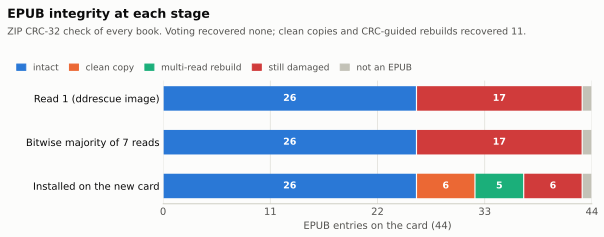
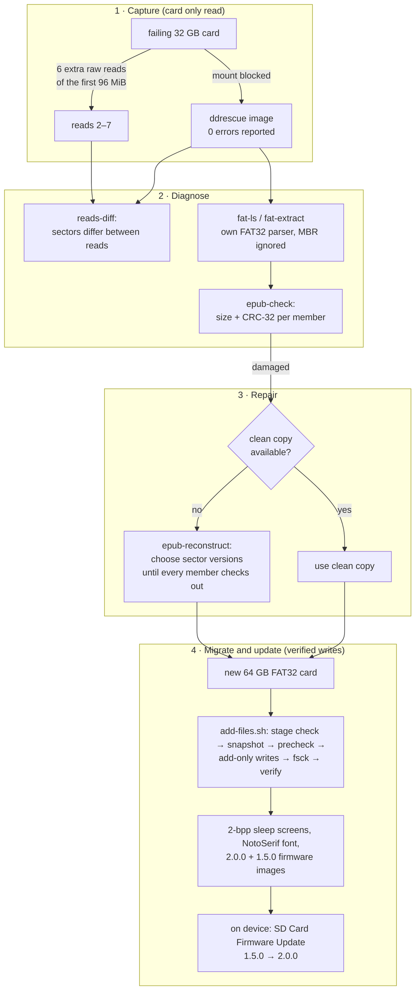
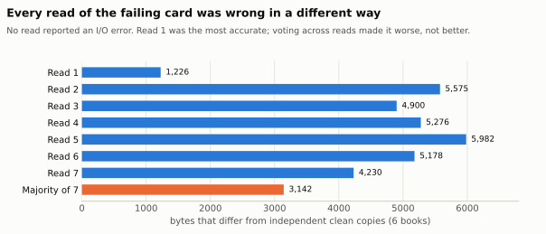
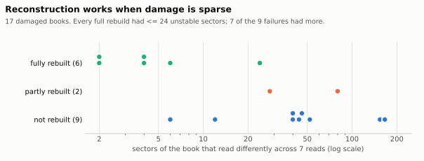
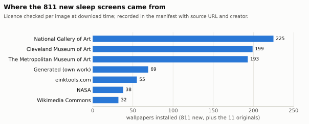
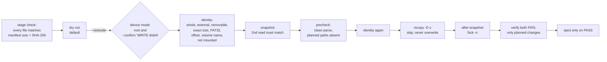

# XteInk X3 Recovery Toolkit

The microSD card of an XteInk X3 e-reader started corrupting books. GNU ddrescue imaged the card
with **0 read errors**, yet 17 of its 44 EPUB entries failed their own checksums, and reading the
same region twice gave different bytes. The card returned plausible but wrong sectors, a
failure that standard recovery tools treat as success.

This repository contains the tools built to deal with it, plus the evidence from using them:

- **Multi-read, checksum-guided reconstruction.** Each 512-byte sector is treated as a set of
  versions seen across several reads. The tool searches for the combination that makes every
  ZIP member decode to its declared size and CRC-32.
- **A FAT32 reader for damaged volumes.** It ignores a corrupt MBR, cross-checks both FATs and
  reports anomalies instead of crashing.
- **A verified write path.** Additions only, a rollback snapshot that is re-read to confirm it,
  a pre-write gate, and a before/after verifier that rejects any change that was not planned.
- **X3-specific parts:** a sleep-screen BMP pipeline for the 4-level panel, offline ESP32
  firmware-image checks, and notes on the CrossPoint 1.5.0 → 2.0.0 upgrade.

> Independent personal project, not affiliated with, sponsored by or endorsed by any employer,
> CrossPoint Reader, CrossInk or XteInk. No firmware, books, card images or personal data are
> included ([NOTICE](NOTICE.md)).

## Results at a glance

These numbers come from the real card. Books are anonymised. The evidence is in
[`docs/data/`](docs/data/) and [docs/recovery-method.md](docs/recovery-method.md).

| | |
|---|---|
| EPUB entries on the card | 44: 43 books and one 80-byte stub that was never a book |
| Damaged in the ddrescue image (failed ZIP CRC-32) | 17 |
| Repaired by a bitwise majority vote across 7 reads | **0** |
| Fully rebuilt by checksum-guided reconstruction | **6** (one matched an independent copy byte for byte) |
| Replaced by clean copies from elsewhere | 6 (including that one) |
| **Still damaged**, copied to the new card as they were | **6** |
| New card | 64 GB FAT32; the final write session passed snapshot, `fsck` and plan verification |
| Firmware | CrossPoint 1.5.0 → 2.0.0 via the on-device SD update; rollback image on the card, **not tested** |
| Sleep screens | 822: 561 pre-dithered 2-bpp, 261 left as 24-bit (11 originals + 250 earlier additions) |

<picture>
  <source media="(prefers-color-scheme: dark)" srcset="assets/charts/epub-integrity-by-stage-dark.svg">
  
</picture>

## Quick start (no hardware needed)

```bash
git clone https://github.com/nicoladelbene/xteink-x3-recovery-toolkit
cd xteink-x3-recovery-toolkit
python3 -m pip install -e .                       # Python >= 3.9, no dependencies
python3 examples/simulate_failing_card.py ./x3-demo
```

The demo builds a synthetic FAT32 image holding a generated EPUB, then makes 7 "reads" of it.
In each read a few weak sectors come back wrong, with no I/O error. The error model is the one
measured on the real card: the errors are correlated, so a majority vote picks the wrong
version. The demo then runs the toolkit's own commands:

```text
$ python -m x3toolkit epub-check 'read1/A Synthetic Book.epub'
FAIL  read1/A Synthetic Book.epub  4 member(s) fail CRC/inflate
$ python -m x3toolkit epub-check 'voted/A Synthetic Book.epub'
FAIL  voted/A Synthetic Book.epub  3 member(s) fail CRC/inflate
$ python -m x3toolkit epub-reconstruct card.img --reads read-02.bin … --path '/A Synthetic Book.epub' --out rebuilt.epub
repaired: 36 sectors, 4 with >1 version across 7 reads
rebuilt.epub is byte-identical to the original book. …
```

Nothing touches a device. For a full write rehearsal on a synthetic card image (mtools),
see [examples/](examples/README.md).

## What is in the box

**Generic: any FAT32 image, any ZIP-based format (EPUB, DOCX, CBZ…)**

| Command | Purpose | Writes |
|---|---|---|
| `fat-ls IMAGE --lba N [--fat 2] [--csv F]` | list every file with hashes and anomalies | only `--csv` |
| `fat-extract IMAGE --lba N OUTDIR` | copy all files out; OUTDIR must be empty, and name collisions are reported, not overwritten | OUTDIR |
| `epub-check FILES…` | ZIP structure, then exact size and CRC-32 of every member | — |
| `reads-diff READS… [--mib M]` | sectors that differ between raw reads | — |
| `reads-vote OUT READS…` | bitwise majority, kept for comparison | OUT |
| `epub-reconstruct IMAGE --lba N --reads … --path /x.epub --out F` | checksum-guided multi-read rebuild | F |
| `fat-used IMAGE --lba N` | MiB a snapshot must cover (either FAT) | — |
| `precheck SNAPSHOT --lba N --manifest M` | pre-write gate | — |
| `verify BEFORE AFTER --lba N --manifest M` | check that a card update changed only what was planned | — |

**X3 / CrossPoint-specific**

| Command | Purpose | Writes |
|---|---|---|
| `bmp-validate FILES…` | check a BMP against the firmware's parser rules; report whether 2.0.0 draws it directly | — |
| `bmp-convert --out DIR [--preset 2bit\|24bit] IMAGES…` | make 528×792 sleep screens (needs Pillow) | DIR |
| `firmware-check BIN --chip ESP32-C3 --sha256 … --max-size 0x640000` | offline ESP32 app-image validation | — |

**Device paths are never used.** Paths are resolved through symlinks, and anything that turns
out to be a device under `/dev` is refused, for inputs and outputs alike, even with `--force`.
Without `--force`, existing output is never overwritten.

**macOS scripts** (`scripts/macos/`; dry run by default; need `brew install ddrescue mtools`):

- **`image-card.sh`** makes a read-only ddrescue image, plus optional extra raw reads.
- **`add-files.sh`** writes files to a card add-only and verifies the result. It runs against a
  device, or against an image file for rehearsal.
- **`mount-blocker.swift`** refuses macOS automounts of external disks while it runs. Build it
  with `swiftc scripts/macos/mount-blocker.swift -o mount-blocker`.

## How it works



**One read is one sample.** On a card that returns silently wrong data, every 512-byte sector
is treated as the set of distinct versions seen across all reads. A sector that never varies is
probably right. A sector with several versions is unknown.

**The file format decides.** Each ZIP member carries the CRC-32 and size of its contents.
`epub-reconstruct` maps the book to its sectors through the FAT chain, then searches the
versions member by member. For deflated members, it inflates as it goes and abandons a branch
the moment the stream becomes invalid or produces too much output, usually within a few
sectors. A candidate is accepted only if it decodes to exactly the declared size **and**
matches the CRC-32.

**Why not a majority vote?** Voting is only correct if errors are independent and rare. Here
they were neither. The first read was far more accurate than any later one (1,226 wrong bytes
against 4,230–5,982), so the majority was often a wrong value shared by several reads. The vote
repaired none of the 17 books; the checksum-guided search fully rebuilt 6.

**How strong is "rebuilt"?** CRC-32 is an error-detecting code, not a cryptographic hash.
Across the 6 rebuilds, the search examined 18,175 candidates in total. The chance that any wrong
candidate passed by coincidence is therefore at most about 18,175 / 2³² ≈ 4 × 10⁻⁶. The real
chance is lower, because a wrong candidate must also decode exactly. The CRC does **not** cover
ZIP headers, the central directory or timestamps, and it says nothing about whether the book
renders correctly. [docs/recovery-method.md § 7](docs/recovery-method.md#7-what-repaired-means-and-what-it-does-not)
separates the four levels of evidence: decodes, CRC matches, byte-identical to an independent
copy, semantically correct.

## Results in detail

<picture>
  <source media="(prefers-color-scheme: dark)" srcset="assets/charts/wrong-bytes-per-read-dark.svg">
  
</picture>

<picture>
  <source media="(prefers-color-scheme: dark)" srcset="assets/charts/reconstruction-outcomes-dark.svg">
  
</picture>

| Stage | Intact | From clean copy | Multi-read rebuild | Still damaged | Not an EPUB |
|---|---:|---:|---:|---:|---:|
| Read 1 (ddrescue image) | 26 | – | – | 17 | 1 |
| Bitwise majority of 7 reads | 26 | – | – | 17 | 1 |
| **Installed on the new card** | **26** | **6** | **5** | **6** | **1** |

- **Rebuild counts:** six books were fully rebuilt. One of them is counted under *clean copy*,
  because an independent copy existed and matched the rebuild byte for byte.
- **The 6 still-damaged books:** they are on the new card as they were. How much of each is
  readable has not been measured.
- **Why the others failed:** of the 11 books not fully rebuilt, 5 had at least one sector whose
  correct version never appeared in any read, and the search budget ran out on the rest.
- **Re-checked after the audit fixes:** re-running the published code on the private reads
  reproduces exactly 26 intact, 6 rebuilt (all byte-identical to the installed files),
  2 partial and 9 not rebuilt.

| What was checked | How | Result |
|---|---|---|
| Original card | full ddrescue image (31,268,536,320 B) and 6 extra reads of the first 96 MiB | never written |
| Final write session | snapshots re-read and compared; `fsck_msdos -n`; `verify` against the plan | PASS; the 44 EPUB entries and 11 original wallpapers match the migration tree; all 415 files of the reader's state folder unchanged |
| On the device, by the owner, after the upgrade | booting, opening a book, sleep/wake | 2.0.0 boots; the book opened kept its reading position; NotoSerif renders; custom wallpapers appear. Not every book or wallpaper was opened individually |
| Firmware images | `firmware-check` against the published SHA-256 | both official images pass |

<picture>
  <source media="(prefers-color-scheme: dark)" srcset="assets/charts/wallpapers-by-source-dark.svg">
  
</picture>

Licences were recorded per image. Only three CC0 examples are redistributed here; some of the
others are licensed for personal use only.


## Safety

The guards are designed around the mistakes that actually happen: the wrong disk number, macOS
mounting a card and writing to it, a second run of a script, a snapshot of a card that is still
changing, and a bad stage that stops a session half-way.



- **What the scripts never do:** partition, format, relabel or write raw sectors. They delete
  only macOS metadata folders, and only when asked.
- **`image-card.sh` only reads.** It refuses internal disks, output directories with less than
  3× the card size free, and overwriting an image that has no mapfile.
- **If a session fails** after writing has begun, the banner names the rollback snapshot.
  [docs/safety-and-rollback.md](docs/safety-and-rollback.md) explains:
  - how to tell an interrupted copy from other damage;
  - how to undo at file level or at block level (both rehearsed on synthetic images);
  - what the guards **don't** cover, such as disk-number reuse during a long copy, or a
    deliberate mount.

## Testing and validation

```bash
python3 -m pip install -e ".[test]"
python3 -m pytest -q          # 63 tests; mtools is needed for the end-to-end rehearsals
```

Every test uses **synthetic data**, built in code by `tests/fatbuilder.py` and `tests/conftest.py`.

| Area | What the tests check |
|---|---|
| FAT32 parser | names, sizes and contents survive a walk; both FATs give the same tree; the FATs disagree; chain loops; **directory cycles**; **a corrupt total-sector count**; sector-offset mapping; truncated or non-FAT32 images; a used region that counts **either** FAT |
| EPUB check | intact book; a bit flip in a deflated or stored member; **wrong declared size**; missing container; a **property test**: hundreds of truncations and mutations always give a verdict, never an exception |
| Reconstruction | exact recovery; the vote is wrong where the CRC search is right; stable damage reported, not guessed; no read has the correct version; budget; partial re-reads; a damaged header in a shared sector; **a member that runs past end-of-file** |
| CLI | **no device paths, even through symlinks or with `--force`**; **no overwrite on extraction name collisions**; command round trips |
| BMP, wallpapers, firmware | 2-bit layout matches the firmware's writer; palette → panel levels; validation rules; paper flattening; chip, checksum, SHA trailer, size limit |
| Shell scripts | stubbed `diskutil`/`ddrescue`: every identity guard refuses before writing, **including an exact volume-name match**; a real mtools rehearsal: dry run → write → second run refused; **a bad stage refused before the card is touched**; **a failure mid-write names the rollback snapshot** |
| Quick start | the demo above runs and shows the vote failing and the rebuild succeeding |

Items in **bold** are regression tests for defects found in an audit in November 2026. Each one
fails on the code before the fix ([CHANGELOG](CHANGELOG.md)).

- **Fuzzing:** the parsers were also fuzzed with random truncations and byte mutations.
- **Static checks:** `shellcheck` and `bandit` run clean.
- **CI:** Ubuntu and macOS, with Python 3.9 and 3.12.

## Limitations and lessons

**Limitations**
- **Formats:** reconstruction needs a per-file checksum, so it suits ZIP-based formats, not
  plain files. ZIP64 is not supported; EPUBs never need it.
- **Unreadable sectors:** if no read returned the correct version of a sector, that sector
  cannot be recovered.
- **Search cost:** it grows exponentially with the number of unstable sectors per member.
  Beyond about 25 the search usually exhausts its budget. "Budget exhausted" is inconclusive,
  not a proof that no answer exists.
- **Platform:** the write and imaging scripts are macOS-only (`diskutil`). The Python package
  is portable.
- **Device behaviour** was read from the firmware source at public tags. Only the upgrade path
  described here was exercised on a device.

**Lessons**
- "0 read errors" describes the transport, not the data. Read more than once and compare.
- Do the extra reads early: a degrading card returns fewer correct versions over time.
- A format with built-in checksums turns recovery into a search with a strong acceptance test,
  as long as you are precise about what the checksum does not cover.
- Make the safe path the default: dry runs, explicit confirmation, a snapshot verified by a
  second read, a verifier that knows the plan, and a stage that is checked before the card is.

## Documentation

| Page | Contents |
|---|---|
| [docs/recovery-method.md](docs/recovery-method.md) | the failure, the FAT32 reader, the reconstruction search, results, evidence levels |
| [docs/safety-and-rollback.md](docs/safety-and-rollback.md) | guards, snapshot coverage, interrupted sessions, rollback, known limits |
| [docs/firmware-1.5-to-2.0.md](docs/firmware-1.5-to-2.0.md) | CrossPoint upgrade: card-level changes, how it was done, untested rollback paths |
| [docs/wallpapers.md](docs/wallpapers.md) | sleep-screen BMP format, conversion pipeline, licensing |
| [docs/customisation.md](docs/customisation.md) | settings catalogue for the X3 |
| [examples/](examples/README.md) | write rehearsal on a synthetic image, manifest tools |

## AI-assisted development

This project was developed with **Claude Code** (Anthropic's Claude Opus 5.5) as an engineering
assistant. It did the research in the firmware source, wrote most of the code, tests and
documentation, and designed the safety checks. It also ran the November 2026 audit recorded in
the [CHANGELOG](CHANGELOG.md).

Every operation on the physical card and the device was run by the owner, after reviewing the
exact script and its dry-run output. The numbers here were checked against the session logs and
the private evidence files. AI-written code is held to the same bar as any other code: synthetic
tests, plus reproducing the results on the real data.

## Licence and acknowledgements

- **Code and documentation:** MIT ([LICENSE](LICENSE)).
- **Example wallpapers:** derived from CC0 works at The Cleveland Museum of Art and The
  Metropolitan Museum of Art ([NOTICE](NOTICE.md)).
- **Thanks** to:
  - the [CrossPoint Reader](https://github.com/crosspoint-reader/crosspoint-reader) developers,
    for open firmware with readable source;
  - GNU ddrescue and mtools;
  - the museums whose open-access programmes made the sleep screens possible.
