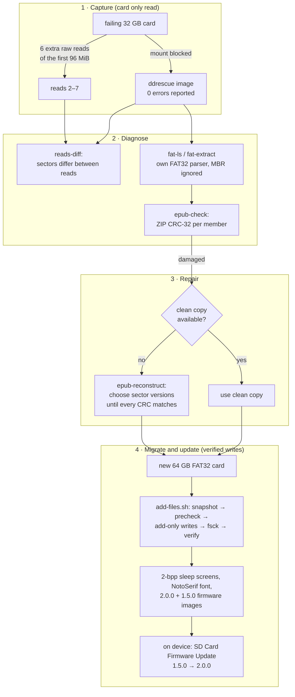
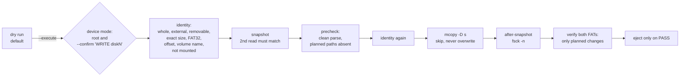

# XteInk X3 Recovery Toolkit

Tools and notes from rescuing the microSD card of an XteInk X3 e-reader. The card returned
**silently wrong data**: every read succeeded, and every read was different. The same work
then covered moving everything to a new card, verifying that each write changed only what was
planned, generating sleep screens suited to a 4-level e-ink panel, and upgrading the CrossPoint
firmware from 1.5.0 to 2.0.0.

The code is a small Python package (`x3toolkit`, standard library only, with optional Pillow) plus
guarded macOS shell scripts. Most of it applies to any FAT32 card and any ZIP-based file format,
not just this device.

> Independent project. Not affiliated with or endorsed by CrossPoint Reader, CrossInk or XteInk.
> No firmware, books, card images or personal data are included. See [NOTICE](NOTICE.md).

## Contents

1. [The problem](#the-problem)
2. [Workflow](#workflow)
3. [Method](#method)
4. [Results](#results)
5. [Technical challenges and decisions](#technical-challenges-and-decisions)
6. [Installation](#installation)
7. [Usage](#usage)
8. [Safety](#safety)
9. [Testing and validation](#testing-and-validation)
10. [Limitations and lessons](#limitations-and-lessons)
11. [AI-assisted development](#ai-assisted-development)
12. [Licence and acknowledgements](#licence-and-acknowledgements)

## The problem

The X3 started showing broken books. The 32 GB card (FAT32) was imaged with GNU ddrescue, which
reported **100 % rescued, 0 read errors**. Yet 17 of the 44 EPUBs in the image failed their own
CRC checks, the partition table had 27 flipped bits, and reading the same 96 MiB again gave
between 536 and 632 sectors with different contents each time.

The card wasn't failing to read. Its controller was returning sectors that looked plausible but
were wrong. Standard recovery tools treat a sector that reads without error as correct, so they
can't detect this kind of failure.

The goals were:
- get as many books back as possible, **proving** each one correct rather than assuming it;
- keep the reading positions and settings;
- move everything to a new card without disturbing what was already verified;
- add 811 sleep screens;
- upgrade the firmware;
- touch the device as little as possible throughout.

## Workflow



## Method

### Treat a successful read as a guess

When a card returns silently wrong data, one image is one sample. The toolkit treats each
512-byte sector as a set of **versions**: the distinct contents seen across all reads. A sector
that reads the same every time is probably correct. A sector with several versions is unknown.

### Use the file format to decide

The method needs something that can say whether a candidate is right. An EPUB is a ZIP archive,
and every member of a ZIP carries a CRC-32 of its contents, so the book can check itself.
`epub-reconstruct`:

1. maps the book to its sectors through the FAT chain;
2. collects each sector's versions from every read;
3. searches the combinations member by member.

For compressed members, the search inflates the stream as it goes and abandons a branch the
moment the stream becomes invalid. Usually that happens within the next few sectors, which keeps
the search small. A rebuilt member is accepted only if its CRC-32 and size match exactly.

### Why this is more than a majority vote

Voting across the 7 reads repaired **none** of the 17 damaged books. The errors weren't random
noise: later reads were *less* accurate than the first, so the majority was often wrong.
Choosing per sector against a CRC fully rebuilt 6. One of the 6 could be checked against a clean
copy from another source, and the two were byte-identical.

The full method and the design decisions are in [docs/recovery-method.md](docs/recovery-method.md).

## Results

These numbers come from the real card and the verified session logs, not from simulations. Books
are anonymised as `book-NN`. Per-stage and per-book data is in [`docs/data/`](docs/data/).

<picture>
  <source media="(prefers-color-scheme: dark)" srcset="assets/charts/epub-integrity-by-stage-dark.svg">
  
</picture>

| Stage | Intact | From clean copy | Multi-read rebuild | Still damaged | Not an EPUB |
|---|---:|---:|---:|---:|---:|
| Read 1 (ddrescue image) | 26 | – | – | 17 | 1 |
| Bitwise majority of 7 reads | 26 | – | – | 17 | 1 |
| **Installed on the new card** | **26** | **6** | **5** | **6** | **1** |

Not every book was repaired. **6 of the 44 entries remain damaged.** They were copied to the new
card as they were and still contain errors; how much of each is readable has not been measured.
Six books were fully rebuilt, but one of them is counted under clean copy: an independent clean
copy existed and matched the rebuild byte for byte. The "not an EPUB" entry is an 80-byte stub
that was never a book.

<picture>
  <source media="(prefers-color-scheme: dark)" srcset="assets/charts/wrong-bytes-per-read-dark.svg">
  
</picture>

<picture>
  <source media="(prefers-color-scheme: dark)" srcset="assets/charts/reconstruction-outcomes-dark.svg">
  
</picture>

| Migration and device outcome | Result |
|---|---|
| Original card | full ddrescue image (31,268,536,320 B) and 6 extra reads of the first 96 MiB; never written |
| New card | 64 GB, FAT32. Before the firmware upgrade, the 44 EPUB entries and 11 original wallpapers matched the verified migration tree byte for byte, and all 415 files of the reader's state folder (settings, 6 reading-progress files) were unchanged by the final write session |
| Sleep screens | 822 in total: 11 originals + 811 new 2-bpp images (licence recorded per image) |
| Firmware | CrossPoint 1.5.0 → **2.0.0** through the on-device SD-card update; 1.5.0 image kept on the card for rollback |
| Final write session | before/after snapshots verified by a second read; `fsck -n` clean; verifier: only planned additions |
| Checked on the device | 2.0.0 boots; reading position kept; NotoSerif works; sleep/wake wallpapers work; all books and wallpapers present |

<picture>
  <source media="(prefers-color-scheme: dark)" srcset="assets/charts/wallpapers-by-source-dark.svg">
  
</picture>

Only three CC0 examples are redistributed here (below). The other wallpapers stay on the device;
some of them are licensed for personal use only.


## Technical challenges and decisions

| Challenge | Decision |
|---|---|
| The MBR was corrupt, and macOS wanted to "repair" the volume | own read-only FAT32 parser with an explicit partition offset; FAT1 and FAT2 cross-checked; macOS automounting blocked during imaging (`mount-blocker.swift`) |
| No read could be trusted | the ZIP CRC-32 is the only judge of correctness; nothing is accepted without it |
| A majority vote made things worse | dropped as a method; kept as a `reads-vote` command so the comparison can be reproduced |
| A sector shared by two ZIP members | byte-range constraints (`_Pins`) instead of locking whole sectors |
| Pinning unverified header bytes blocked repairs | pin only the verified members' signatures and lengths, plus the central directory |
| Deep searches hit Python's recursion limit | iterative depth-first search with an explicit stack, and a node budget |
| Writing to the only good copy of the data | add-only writes (`mcopy -D s`), a rollback snapshot verified by a second read, a pre-write gate, identity re-checked just before writing, and a verifier that walks both FATs |
| 2.0.0 re-dithers sleep images and washes them out (upstream #4301) | pre-dither to 2 bpp, palette 0/85/170/255, which 1.5.0 and 2.0.0 both draw directly ([docs/wallpapers.md](docs/wallpapers.md)) |
| 2.0.0 dropped the built-in Noto Serif | installed the official `NotoSerif` SD font before the upgrade, so books did not re-lay out in Noto Sans |
| Upgrading without Wi-Fi or USB flashing | the firmware's own *SD Card Firmware Update*: it validates the image and writes the inactive OTA slot ([docs/firmware-1.5-to-2.0.md](docs/firmware-1.5-to-2.0.md)) |

## Installation

Requires Python ≥ 3.9. The core has no dependencies.

```bash
git clone https://github.com/nicoladelbene/xteink-x3-recovery-toolkit
cd xteink-x3-recovery-toolkit
python -m pip install -e ".[images]"     # Pillow, only for bmp-convert
python -m x3toolkit --help
```

The macOS scripts also need `brew install ddrescue mtools`. To build the mount blocker, run
`swiftc scripts/macos/mount-blocker.swift -o mount-blocker` (requires the Xcode command-line tools).

## Usage

| Command | Purpose | Writes? |
|---|---|---|
| `fat-ls IMAGE --lba N [--fat 2] [--csv F]` | list every file, with hashes and anomalies | only `--csv` |
| `fat-extract IMAGE --lba N OUTDIR` | copy all files out (OUTDIR must be empty) | OUTDIR |
| `epub-check FILES…` | ZIP structure plus CRC-32 of every member | no |
| `reads-diff READS… --mib M` | sectors that differ between raw reads | no |
| `reads-vote OUT READS…` | bitwise majority, for comparison | OUT |
| `epub-reconstruct IMAGE --lba N --reads … --path /x.epub --out F` | CRC-guided multi-read rebuild | F |
| `bmp-validate FILES…` | check against the firmware's BMP rules; direct-on-2.0.0 or converted | no |
| `bmp-convert --out DIR [--preset 2bit\|24bit] [--preview] IMAGES…` | make X3 sleep screens | DIR |
| `firmware-check BIN --chip ESP32-C3 --sha256 … --max-size 0x640000` | offline ESP32 app-image validation | no |
| `fat-used IMAGE --lba N` | MiB that a snapshot needs to cover all allocated data | no |
| `precheck SNAPSHOT --lba N --manifest M` | pre-write gate: clean parse, no planned path exists | no |
| `verify BEFORE AFTER --lba N --manifest M` | prove a card update changed only what was planned | no |

None of these opens a device: `/dev/*` paths are refused, so they work on images only. Existing
output is never overwritten without `--force`. Worked examples, including a full write rehearsal
on a synthetic image, are in [examples/](examples/README.md).

The scripts in `scripts/macos/` (dry run by default):

- **`image-card.sh`** makes a read-only ddrescue image and optional extra raw reads.
- **`add-files.sh`** writes to a card add-only and verifies the result, either on a device or
  on an image file for rehearsal.
- **`mount-blocker.swift`** stops macOS from mounting (and writing to) a card while it is
  attached.

## Safety

**What the safeguards catch.** They are designed around the mistakes that actually happen:
- the wrong disk number;
- a card that macOS mounted and wrote to without asking;
- a second run of a script;
- a snapshot taken from a card that is still changing.

**Guards in `add-files.sh`, in order:**



**What the scripts never do:**
- partition, format or relabel a disk;
- write raw sectors;
- delete anything except macOS metadata folders, and then only when asked.

**`image-card.sh`** only reads. It refuses to:
- read an internal disk;
- run when the output directory has less than 3× the card's size free;
- overwrite an image that has no mapfile.

It also skips retries when more than 0.5 % of the card is unreadable.

**On a failing card:** stop using it, block automounting, and image it once with extra reads
of the region in use. Never write to the original. See [SECURITY.md](SECURITY.md).

## Testing and validation

```bash
python -m pip install -e ".[test]"
python -m pytest -q          # 50 tests; mtools needed for the end-to-end rehearsal test
```

All tests run on **synthetic data**, built in code by `tests/fatbuilder.py` and `tests/conftest.py`:

| Area | What the tests check |
|---|---|
| FAT32 parser | long names, sizes and contents survive a walk; both FAT copies give the same tree; FAT copies that disagree; chain loops; sector-offset mapping; non-FAT32 and truncated images refused; used-region size |
| EPUB check | intact book; one-bit flip in a deflated member; flip in a stored member; missing container; garbage input |
| Reconstruction | exact recovery; majority vote wrong where the CRC search is right; stable damage reported, not guessed; no read has the correct version; search budget; partial re-reads; damaged header in a sector shared with a neighbour |
| BMP and wallpapers | 2-bit layout matches the firmware's own writer; palette → panel levels; top-down and bottom-up round trip; 2.0.0-conversion flag; validation errors; trim and crop; blank paper stays clean; paper flattening |
| Firmware check | valid image; wrong chip; corruption and truncation; image larger than the OTA slot |
| Verifier | planned additions pass; any unplanned change fails |
| Shell scripts | stubbed `diskutil`/`ddrescue` prove every identity guard refuses before writing; a real mtools rehearsal runs dry run → write → second run refused |

**Validated on the real (private) data** beyond the synthetic tests:
- `fat-ls` reproduces the file counts of the original card;
- `epub-reconstruct` rebuilds the same 6 books, byte-identical to the files installed on the device;
- `firmware-check` passes on both official images;
- the final card session passed every gate.

CI runs the suite on Ubuntu and macOS with Python 3.9 and 3.12.

## Limitations and lessons

**Limitations**
- **Format support.** Reconstruction needs a per-file checksum, so it covers ZIP-based formats
  (EPUB, DOCX, CBZ…) but not plain files.
- **Unrecoverable sectors.** If no read returned the correct version of a sector, it can't be
  recovered. This was the case for 5 of the 11 books that weren't fully rebuilt.
- **Search cost.** The search is exponential in the number of unstable sectors per member.
  Beyond about 25 it usually exhausts its budget.
- **Platform.** The scripts are macOS-only (`diskutil`). The Python package is portable.
- **Device testing.** Firmware behaviour was read from the source at public tags. Only the
  upgrade path described here was tested on a device. Rollback was prepared but not needed.

**Lessons**
- "0 read errors" is a statement about the transport, not the data. Read more than once and
  compare.
- Do the extra reads early. A degrading card gives fewer correct versions over time.
- A format with built-in checksums turns recovery from guessing into proof.
- Make the safe path the default: dry runs, explicit confirmation, a snapshot verified by a
  second read, and a verifier that knows the plan.

## AI-assisted development

This project was developed with **Claude Code** (Anthropic's Claude Opus 5.5) acting as an
engineering assistant. It did the research in the firmware source, wrote most of the code,
tests and documentation, and designed the safety checks.

Every operation on the physical card and the device was run by the owner after reviewing the
exact script and its dry-run output. All numbers here were checked against the session logs
and the private evidence files. AI-written code is held to the same bar as any other code here:
it has to pass synthetic tests and reproduce the results on the real data.

## Licence and acknowledgements

- **Code and documentation:** MIT ([LICENSE](LICENSE)).
- **Example wallpapers:** derived from CC0 works at The Cleveland Museum of Art and The
  Metropolitan Museum of Art ([NOTICE](NOTICE.md)).
- **Thanks** to the [CrossPoint Reader](https://github.com/crosspoint-reader/crosspoint-reader)
  developers for open firmware with readable source; to GNU ddrescue and mtools; and to the
  museums whose open-access programmes made the sleep screens possible.

Firmware behaviour notes: [docs/firmware-1.5-to-2.0.md](docs/firmware-1.5-to-2.0.md) ·
Settings catalogue: [docs/customisation.md](docs/customisation.md) ·
Sleep-screen format: [docs/wallpapers.md](docs/wallpapers.md)
