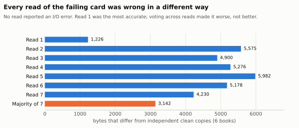
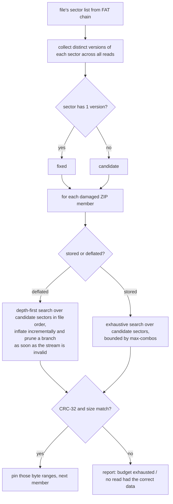
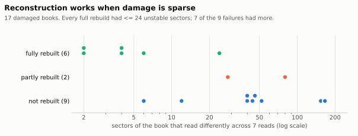

# Recovering a silently corrupted microSD card

This is the method behind `fat-ls`, `fat-extract`, `epub-check`, `reads-diff`, `reads-vote` and
`epub-reconstruct`. The numbers come from one real 32 GB card (31,268,536,320 bytes, FAT32)
taken out of an XteInk X3. Books are listed only as anonymous `book-NN`.

## 1. The failure: no errors, wrong data

GNU ddrescue read the whole card with **0 read errors, 100 % rescued**. The image still
contained damaged files. Reading the same region again gave *different* bytes each time:

| Evidence | Value |
|---|---|
| Sectors in the first 96 MiB that differ between read 1 and reads 2–7 | 632, 596, 600, 550, 536, 546 |
| Bit flips in the MBR (the partition table no longer parsed) | 27 |
| FAT1 vs FAT2 entries that disagree | 268 (all of them in free clusters) |
| EPUBs failing their ZIP CRC-32 check in read 1 | 17 of 44 (plus one 80-byte stub that was never a book) |

The controller's own error correction was returning plausible but wrong sectors. A clean
ddrescue log only shows the card *answered*. It does not show the answers were correct.

> **Rule 1:** never trust a single image of a degraded card. Read the important region more
> than once, then compare the reads (`x3toolkit reads-diff`).

## 2. Parse the filesystem without trusting the damaged parts

`x3toolkit.fat32.Fat32Volume` is a small, read-only FAT32 reader written for damaged media:

- It ignores the MBR. You give it the partition start (`--lba`), which you can usually read off
  the replacement card or find by looking for the boot-sector signature.
- It reads only the boot sector and the FAT copy you choose (`--fat 1|2`).
  `compare_fat_copies` reports where FAT1 and FAT2 disagree. On this card they agreed on every
  cluster in use.
- It handles long file names (LFN) and validates their checksums. Chain loops, chains that point
  outside the volume, cross-linked clusters, places where FAT1 and FAT2 disagree, and unsafe names
  are all reported as *anomalies*. The parse continues past them.
- `fat-extract` refuses to write into a non-empty directory and rejects names that would escape it.

## 3. A per-file oracle: ZIP CRC-32

EPUB is a ZIP container. Each member stores a CRC-32 of its uncompressed data, so the file
itself can tell you whether a candidate reconstruction is very likely right. `epub-check`
checks:

1. that the central directory parses (bounds-checked: a truncated or malformed archive
   gets a FAIL verdict, never a crash);
2. that every member's local header is present and its data lies inside the file;
3. that every deflated member decodes as a valid stream ending exactly at its compressed end,
   to **exactly its declared uncompressed size**, with a matching **CRC-32**. Stored members are
   checked for size and CRC-32;
4. that `META-INF/container.xml` is present;
5. a second opinion from Python's `zipfile.testzip`, which also checks that local and central
   file names match.

See [section 7](#7-what-repaired-means-and-what-it-does-not) for what a pass does and
does not establish.

## 4. Why a majority vote fails

With 7 reads, a bitwise majority vote seems like the obvious fix. It made things **worse**.

<picture>
  <source media="(prefers-color-scheme: dark)" srcset="../assets/charts/wrong-bytes-per-read-dark.svg">
  
</picture>

The vote is worse because the errors are not independent noise around a true value:

- The first read was far more accurate than any later read (1,226 wrong bytes against 4,230–5,982), so
  the "majority" was often a wrong value that several reads shared.
- The vote repaired **0** of the 17 damaged books.

## 5. CRC-guided multi-read reconstruction

`x3toolkit.reconstruct.repair_zip` treats each **512-byte sector** as a choice between
the versions the reads returned, and uses the ZIP CRCs to choose:

Details that turned out to matter on real data:

- **Pin byte ranges, not whole sectors.** One sector can hold the end of one member and the
  start of the next. Locking the whole sector after the first repair blocked the second one.
  `_Pins` records exactly which bytes are already decided.
- **Pin only what has been verified.** For members that verify, only the local-header signature and
  the length fields are pinned, together with the central directory. A damaged member's header
  is never pinned: it may contain flipped bytes, and pinning it prevented a real repair.
- **Recheck afterwards.** A sector chosen for one member can also fix a neighbouring member.
  All members are re-verified at the end.
- **Iterative search.** The depth-first search uses an explicit stack, so large members do not
  hit Python's recursion limit.

## 6. Results on the real card

<picture>
  <source media="(prefers-color-scheme: dark)" srcset="../assets/charts/reconstruction-outcomes-dark.svg">
  
</picture>

| Outcome | Books | What limited it |
|---|---|---|
| Fully rebuilt, every CRC matches | 6 | — |
| Partly rebuilt | 2 | for some sector, no read had the correct data |
| Not rebuilt | 9 | search budget exhausted (6), no read had the correct data (2), both (1) |

Per-book data is in [`data/multiread-reconstruction.csv`](data/multiread-reconstruction.csv).

- **Checking the rebuilds:** one rebuilt book also had a clean copy from another source, and the
  two were byte-identical.
- **Re-running the published code:** run against the private reads, it produces files
  byte-identical to the rebuilds that were installed.
- **Final state of the card:** 26 books were intact, 6 more came from clean copies and 5 more
  from rebuilds, leaving 6 books damaged.

**When the method works:** damage is sparse, there are fewer than about 25 unstable sectors per
book, and at least one read has the correct data for each sector. More reads help only if they
return *new* versions. Run the extra reads early, before the card degrades further.

## 7. What "repaired" means, and what it does not

There are four levels of evidence. They are easy to conflate:

| Level | What it establishes | Holds for |
|---|---|---|
| **Decodes** | every member inflates without error, ending exactly at its compressed end, to exactly its declared size | all 26 intact books and all 6 rebuilds |
| **CRC-32 matches** | each member's content matches the checksum stored when the archive was written | the same 32 books |
| **Byte-identical to an independent copy** | the whole file, headers and directory included, equals a copy obtained elsewhere | **1** of the 6 rebuilds (book-06). The 6 clean copies are independent by definition, but were not compared with a third source |
| **Semantically correct** | the book opens, renders and reads correctly | **not tested** book by book; one book was opened on the device after the upgrade, and its reading position was intact |

**Why CRC-32 is strong evidence, but not proof.** CRC-32 is a 32-bit error-detecting code,
not a cryptographic hash.

- **Random errors:** a wrong candidate matches a given CRC-32 with probability about 2⁻³²,
  under the usual model that the code behaves like a random function for errors this large.
  The search tests at most one CRC per node examined. The 6 rebuilds together examined
  **18,175** nodes, so the chance that *any* of them was accepted by coincidence is at most
  about 18,175 / 2³² ≈ **4 × 10⁻⁶**. The real chance is lower still: a wrong candidate must
  also decode as a valid deflate stream with exactly the right length, and that rejects
  almost every wrong combination long before the CRC is tested.
- **Deliberate tampering:** CRC-32 is linear and easy to forge, so it offers no protection.
  That is irrelevant to random flash errors, but it means none of this is an authenticity
  check.

**What no checksum covers.** In a ZIP archive, the CRC protects only each member's content.
These bytes are taken from the first read and are not verified by any checksum:
- the central directory;
- the archive comment;
- local-header fields other than the lengths (timestamps, flags, the duplicate CRC field).

A flipped timestamp in a rebuilt book would go unnoticed. A flip that breaks parsing would
not, because the file would then fail `epub-check`. Only book-06 was verified at this level,
by the independent copy.

**Search completeness.**
- **Within its budget, the search is exhaustive over the versions actually read.** Branches
  are pruned only when the deflate stream becomes invalid, or when it produces more output than
  the declared size. A correct prefix never fails either test, so pruning never discards the
  true answer.
- **"Not rebuilt" therefore means one of two things:** the budget ran out (an inconclusive
  result, not a proof that no answer exists), or the correct version of some sector was never
  read (a definite negative for that set of reads).
- **Stored members are searched exhaustively** up to `--max-combos` combinations.

**Memory and performance.**
- Reads are memory-mapped, not loaded. Each book is assembled in memory, a few MB for an EPUB.
- The depth-first search keeps one inflater state per sector on its stack.
- Every damaged book on the real card took under 2 s with the default budget of 400,000 nodes.

## 8. Recommended procedure

1. Stop using the card. Block automatic mounting: macOS writes `.fseventsd` and Spotlight
   files as soon as it mounts a card (`scripts/macos/mount-blocker.swift`).
2. Make an image with ddrescue, plus a few extra raw reads of the region in use:
   `scripts/macos/image-card.sh --extra-reads 6 --extra-mib 96`.
3. `x3toolkit reads-diff` the reads. If no sectors differ, the image is probably fine. If some
   do, treat every file as suspect.
4. Run `x3toolkit fat-ls --csv` on the image (try both `--fat 1` and `--fat 2`), then
   `fat-extract`.
5. Run `epub-check` on every book. Use clean copies where you have them, then run
   `epub-reconstruct` for the rest.
6. Copy everything to a **new** card. Never write to the failing one.
