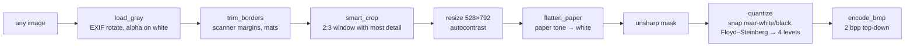
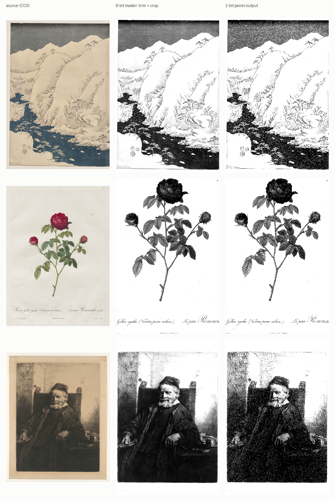
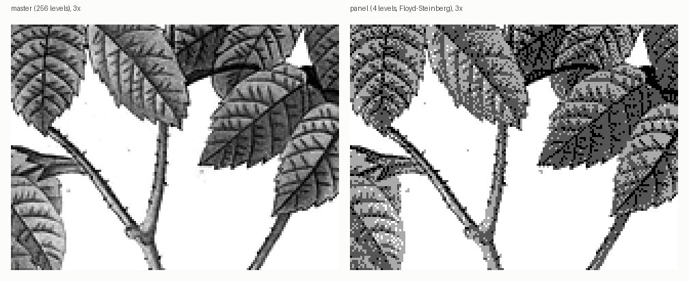

# Sleep screens for the X3

The X3 panel is **528 × 792** and shows **four gray levels**. CrossPoint picks a random BMP
from `/.sleep` each time the device sleeps (with *Sleep screen = Custom*).

## The format that works on 1.5.0 and 2.0.0

| Field | Value |
|---|---|
| Size | 528 × 792, portrait |
| Bit depth | **2 bpp**, BI_RGB, BITMAPINFOHEADER (40 B), pixel data at offset 70 |
| Palette | 4 entries, ascending: 0, 85, 170, 255 (index 0 = black) |
| Row order | top-down (negative height) |
| File size | 104,614 B |

The firmware maps each palette entry to a display level using `luminance >> 6` [SRC]. This
makes 0/85/170/255 come out as exactly levels 0/1/2/3. A palette value such as 128 would land
on level 2, not between levels. Pixels are packed most-significant bit first.

`x3toolkit bmp-validate` checks a BMP against the firmware's parser rules: signature, header
size, bit depth, compression, maximum size and palette levels. It also tells you whether 2.0.0
draws the file directly or converts it first.

## Conversion pipeline (`bmp-convert`)





The steps that matter most for e-ink:

- **Flattening the paper.** Old prints are scanned on cream or foxed paper. Error diffusion turns
  that texture into scattered dots. `flatten_paper` finds the dominant bright tone and maps it,
  and anything lighter, to pure white.
- **Snapping.** Tones close to white or black are set to the end level *before* dithering, so
  blank areas stay clean.
- **Dithering on the computer.** You get to see exactly what the panel will show, and 2.0.0 does
  not dither the image again.



```bash
pip install Pillow
python -m x3toolkit bmp-convert --out ./sleep --preview ~/Pictures/art/*.jpg   # writes <name>.bmp + <name>.preview.png
python -m x3toolkit bmp-validate ./sleep/*.bmp
```

The `24bit` preset writes the format the device's factory wallpapers use: 24-bit gray,
bottom-up, not pre-dithered. 1.5.0 dithers this format when it draws it. 2.0.0 converts it
once and caches the result.

On the device in this project, **561** sleep screens are 2-bpp and **261** are 24-bit: the 11
originals and 250 images added in an earlier session, left byte-identical on purpose. Upstream
#4301 suggests the 24-bit ones may look lighter on 2.0.0. They have not been compared one by
one.

## Many images in one folder

- On every sleep, 1.5.0 lists `/.sleep` and reads each BMP's header. With 822 files that
  should add roughly a second [INF]. The delay was not measured.
- Short names such as `0001.bmp` keep the in-memory list small.
- Subfolders of `/.sleep` are skipped in both versions [SRC]. That means `/.sleep/reserve/` is a
  safe place to park images you don't want in rotation.

## Licensing — check every image

A wallpaper is a copy of an artwork or photo. Use only images you have the right to copy and,
if you share a card or a repository, the right to redistribute. Sources that worked well:

| Source | Basis |
|---|---|
| National Gallery of Art, Cleveland Museum of Art, The Met (Open Access) | CC0 for public-domain works; check each object's flag |
| Wikimedia Commons | per-file licence; take only public domain or CC0 if you don't want attribution duties |
| NASA | NASA media guidelines (generally not copyrighted, with exceptions; no endorsement implied) |
| Your own photos or generated images | yours |

Some wallpaper sites offer files for personal use only. Those can go on your own device, but you
must not redistribute them. Keep a manifest for every image with its source URL, creator,
licence and SHA-256. For the device in this project, 811 new images were installed from the
sources in the [README chart](../README.md#results-in-detail). This repository redistributes only the
three CC0 examples listed in [NOTICE](../NOTICE.md).
